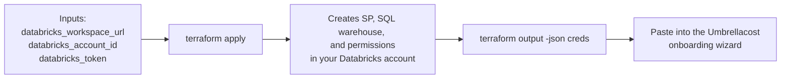

<p align="center">
  
</p>

# terraform-databricks-umbrellacost-integration

This module provisions all resources and permissions required to integrate your Databricks account with Umbrellacost. It runs entirely in **customer** Databricks account/workspace — it does not talk to Umbrellacost or submit anything anywhere.

## Contents

- [Overview](#overview)
- [Prerequisites](#prerequisites)
- [Onboarding](#onboarding)
- [Reference](#reference)

## Overview

This module automates onboarding a Databricks account to Umbrellacost. Rather than creating a service principal, warehouse, and permissions by hand in Databricks, you run this module once and provide its output to Umbrellacost.



**What it creates:**

1. A Service Principal (`umbrellacost-billing-sp`)
2. OAuth credentials for the Service Principal
3. A SQL Warehouse (`umbrellacost-billing-warehouse`)
4. Permissions for the Service Principal to use the SQL Warehouse
5. Grants for the Service Principal: `USE_SCHEMA` on `system.billing` and `system.access`, plus table-level `SELECT` on `system.billing.usage`, `system.billing.list_prices`, and `system.access.workspaces_latest`. `system.access` is intentionally not granted schema-wide, since that would also expose `system.access.audit` (the full user audit log). `system.compute` is not granted — it supports a tag-enrichment feature not yet implemented in the export container.

For the exact values to provide and what you'll get back, see [Onboarding](#onboarding).

## Prerequisites

Before running `terraform apply`, the identity used by the `databricks` provider (a user PAT, or a service principal if you're bootstrapping this way) must have:

1. **Account Admin** - to create the service principal.
2. **Metastore Admin on the metastore attached to the target workspace** — required for every `databricks_grant` resource in this module. Account Admin alone is **not** sufficient; without this, `apply` fails partway through with `User does not have MANAGE on Schema/Table ...` (SP, secret, and warehouse resources will have already been created by that point, since grants run last).

   Metastores are account-wide but Metastore Admin isn't a single account setting — with multiple metastores (e.g. multi-region), you must be admin on the **specific one this workspace uses**:
   - Account Console → **Workspaces** → click the workspace → note the **Metastore** name under Storage (e.g. `metastore_aws_us_west_2`)
   - Account Console → **Catalog** → click that exact metastore → **Configuration** tab → confirm **Metastore Admin** is your account. If not: **Edit** → set it → **Save**

3. **A personal access token, generated with "All APIs" scope:**
   - In the target workspace: user avatar (top-right) → **Settings** → **Developer** → **Access tokens** → **Generate new token**
   - **Name**: anything identifiable, e.g. `terraform`
   - **Lifetime**: short-lived is fine — this token is only used for `apply`/`destroy`, not stored anywhere long-term
   - **Scope**: select **Other APIs**, then in **API scope(s)** choose **All APIs**
   - Copy the token

Confirm both admin roles are in place *before* running `apply`.

## Onboarding

1. Clone this repo and `cd onboarding/`.

2. Run `terraform init` , `terraform apply` and provide the three inputs — interatively, or via `terraform.tfvars`. The token needs the roles listed in [Prerequisites](#prerequisites):

   ```
   $ terraform apply

   var.databricks_account_id
     Databricks Account ID (from the Accounts Console)

     Enter a value: c96d1234-1234-1234-1234-e63a997a1234

   var.databricks_workspace_url
     Workspace URL, e.g. https://dbc-xxxxxx.cloud.databricks.com

     Enter a value: https://dbc-b7c31234-1234.cloud.databricks.com

   var.databricks_token
     Personal access token with Account Admin + Metastore Admin privileges

     Enter a value:
   ```

   `databricks_token` is used only for this `apply`/`destroy` — it isn't stored anywhere. Optionally, set `enable_ip_allowlist = true` to restrict workspace access to a set of static egress IPs, passed via `umbrellacost_static_ips`.

3. Once `apply` finishes, read the output:

   ```
   $ terraform output -json creds | jq
   {
     "account_id": "00000000-0000-0000-0000-000000000000",
     "client_id": "11111111-1111-1111-1111-111111111111",
     "client_secret": "dose0000000000000000000000000000",
     "warehouse_id": "0123456789abcdef",
     "workspace_url": "https://dbc-xxxxxxxx-xxxx.cloud.databricks.com"
   }
   ```

   This bundles `client_id`, `client_secret`, `warehouse_id`, `workspace_url`, and `account_id` — exactly the 5 keys the wizard needs.

4. In the Umbrellacost onboarding wizard, choose **Automatically (Terraform)** and paste this JSON into the **Terraform output JSON** field. Umbrellacost parses the credentials and validates connectivity automatically — no manual GRANTs, no separate credential entry.

This repo only sets up your Databricks side — it doesn't submit these values anywhere itself; pasting the output into the wizard is the step that does.

### Local verification (optional)

Before pasting into the wizard, you can sanity-check connectivity yourself with the vendored test script:

```bash
CREDS=$(terraform output -json creds)
python ../test-connection/test_databricks_connection.py \
  --host "$(echo $CREDS | jq -r .workspace_url)" \
  --warehouse_id "$(echo $CREDS | jq -r .warehouse_id)" \
  --client_id "$(echo $CREDS | jq -r .client_id)" \
  --client_secret "$(echo $CREDS | jq -r .client_secret)"
```

A `FAIL` on `system.compute.clusters` is expected — this module intentionally doesn't grant `system.compute` (see [Overview](#overview)). Only `system.billing.usage`, `system.billing.list_prices`, and `system.access.workspaces_latest` need to pass.

## Reference

Requirements, providers, resources, inputs, and outputs are auto-generated from the Terraform source — see [TERRAFORM_DOCS.md](./TERRAFORM_DOCS.md).
